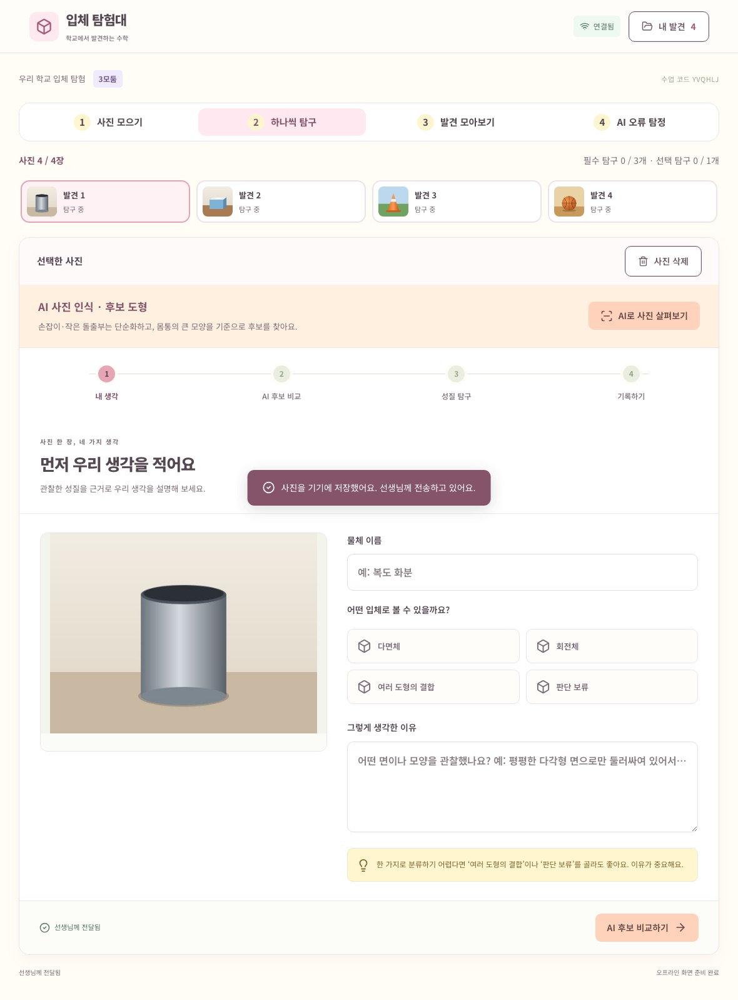
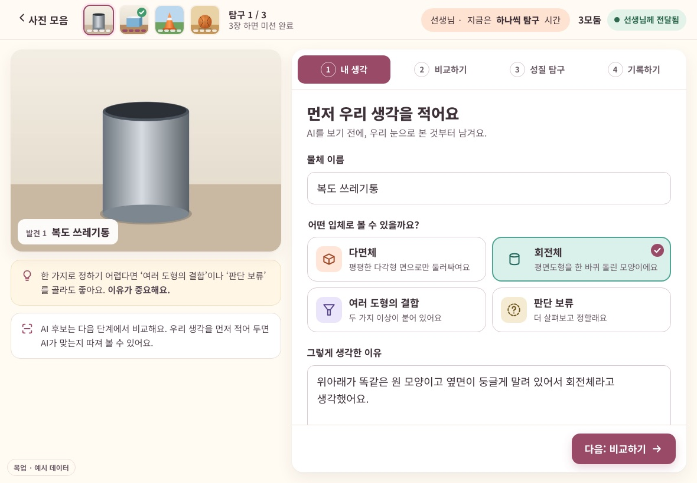
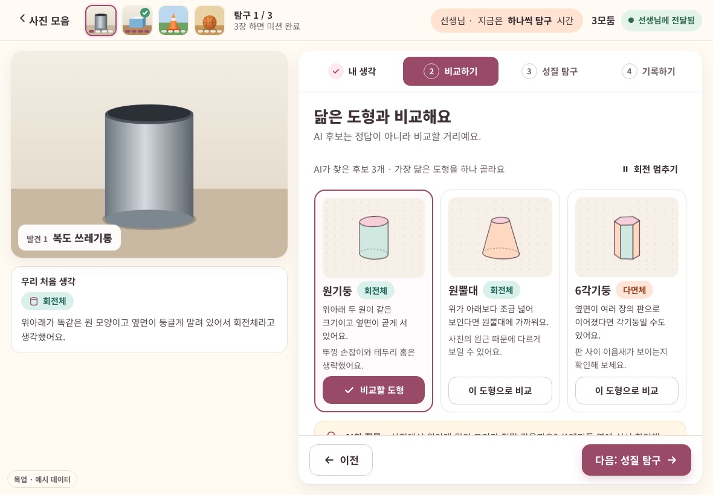
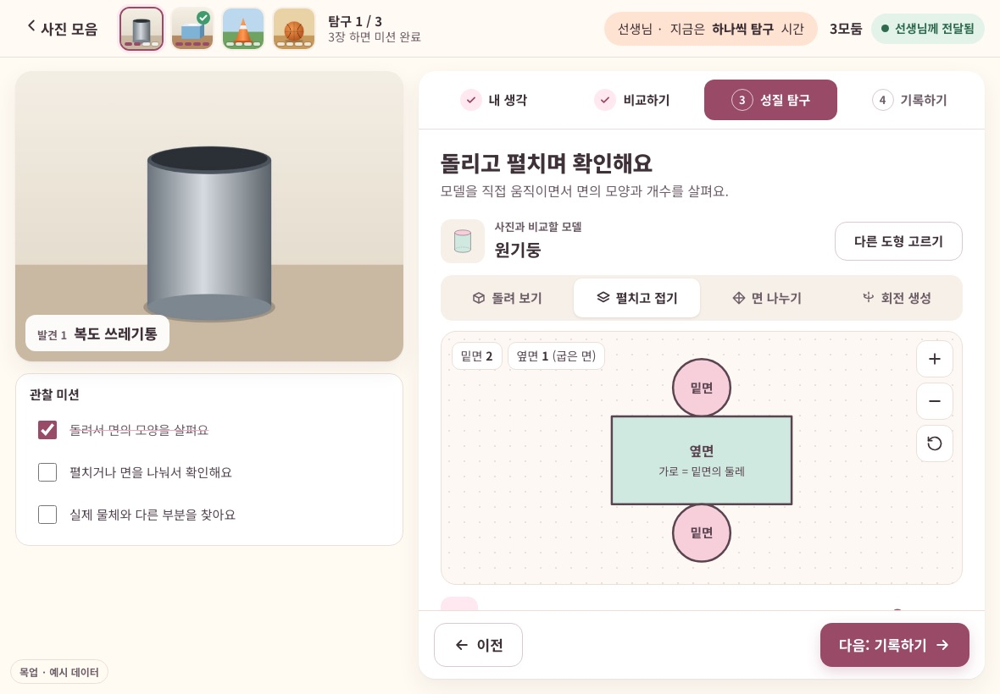
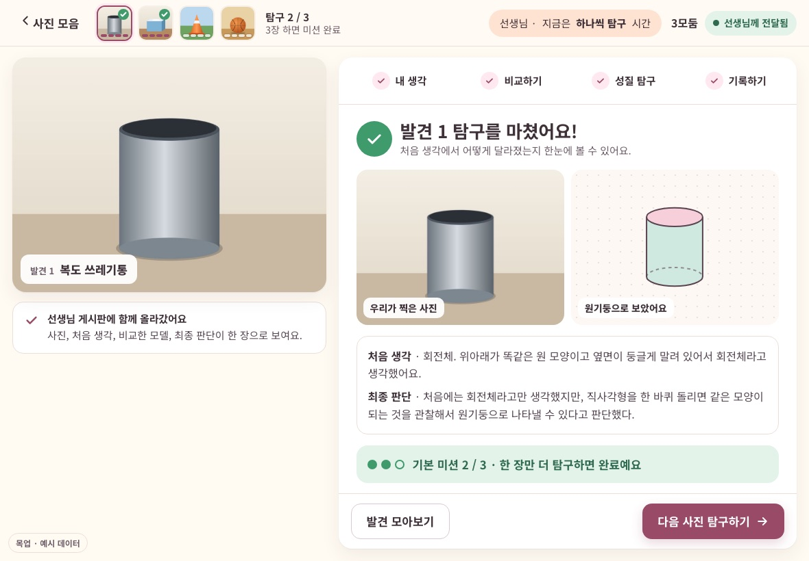
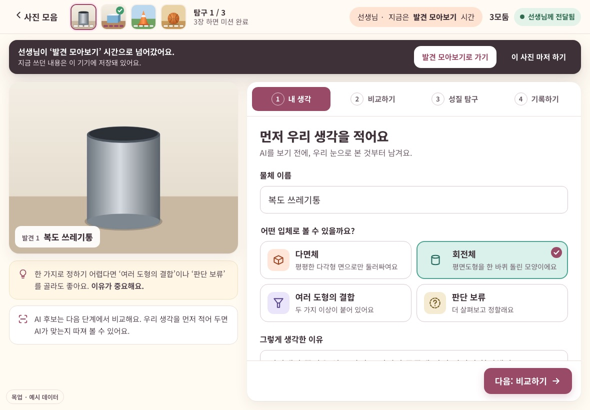
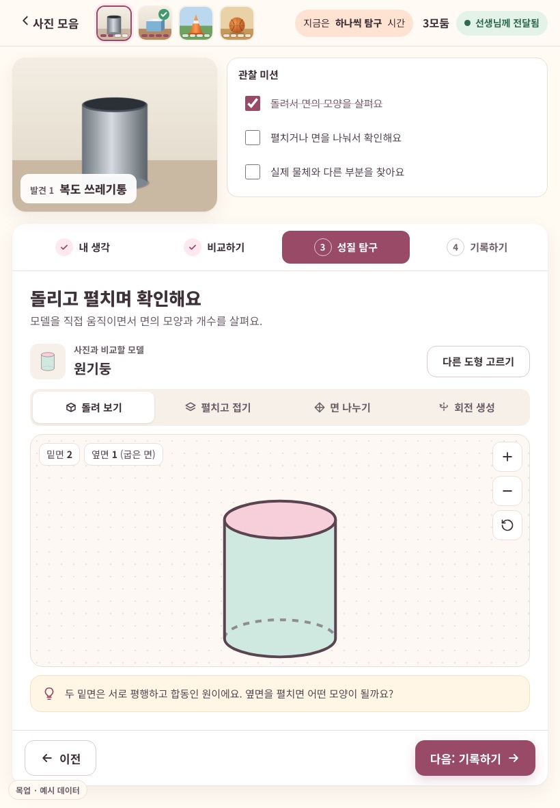
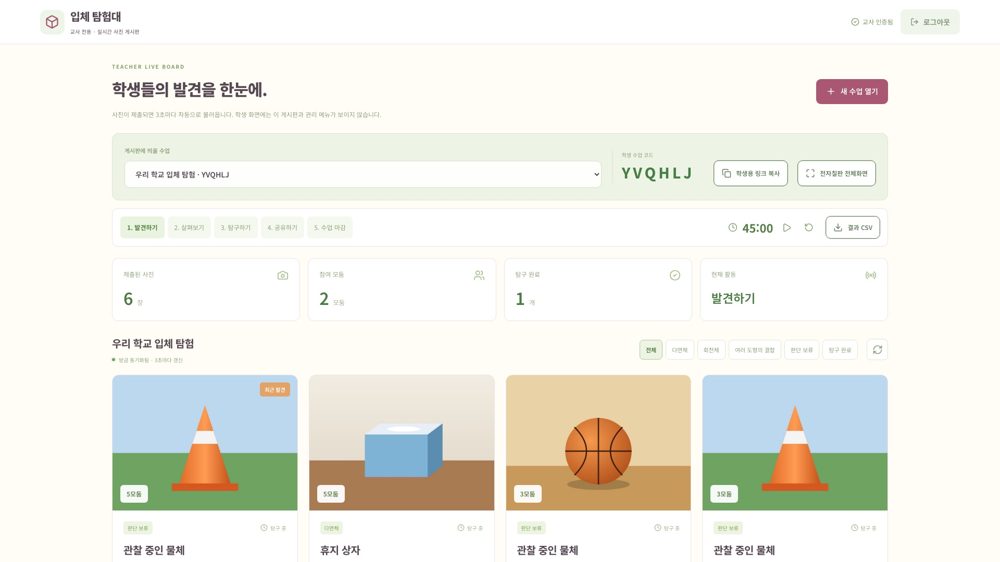
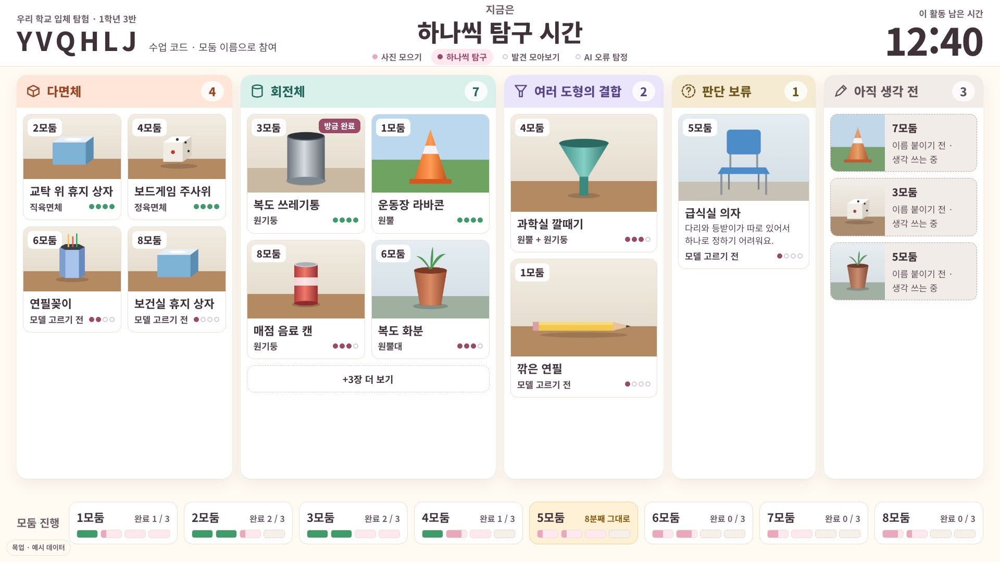
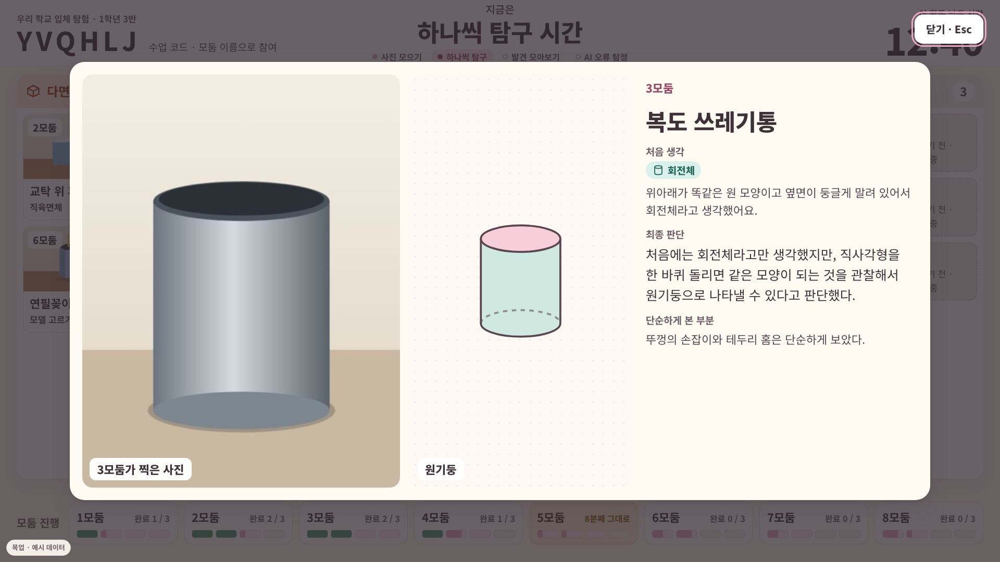

# 입체 탐험대 UI 목업

`design/uiux-mockup` 브랜치에서 UI/UX 점검 결과를 바탕으로 만든 정적 시안이에요.
앱 코드(`app/`, `components/`, `main` 브랜치)는 건드리지 않았고, 이 폴더만 새로 추가했어요.

- 점검 보고서: [CRITIQUE.md](CRITIQUE.md)
- 브라우저에서 바로 열어 보기(화면 안에서 직접 눌러 볼 수 있어요)
  - [학생 탐구 화면](https://htmlpreview.github.io/?https://github.com/leebyongj-del/solid/blob/design/uiux-mockup/design-mockup/student-explore.html)
  - [전자칠판 투사 모드](https://htmlpreview.github.io/?https://github.com/leebyongj-del/solid/blob/design/uiux-mockup/design-mockup/teacher-projector.html)
- 가로·세로·칠판을 한 화면에서 비교하고 상태 버튼으로 바꿔 보려면 로컬에서 `index.html`을 열어요. 이 폴더에서 아래 명령을 실행한 뒤 <http://localhost:5188> 를 열면 돼요.

```bash
python3 -m http.server 5188
```

## 방향

지금의 따뜻한 크림·모브 인상은 그대로 두고 아래 세 가지만 정리했어요.

1. 화면 구조
2. 글자 대비
3. 색의 역할

기능과 문구는 앱과 같아요. 사진은 예시 그림이고, 모둠 기록은 예시 문장이에요.

## 학생 · 사진 한 장 작업대

| 지금 | 목업 |
|---|---|
|  |  |

- 띠 12개를 바 하나로 줄였어요. 바에는 사진 4장과 각 사진의 진행 막대, 선생님 단계, 전달 상태만 남겼어요.
- 사진을 크게 보여 주고, 할 일은 카드 하나에 담았어요. 다음 버튼은 카드 아래에 고정했어요.
- AI는 2단계 '비교하기' 안에만 나와요. AI가 실패하거나 와이파이가 끊기면 그 자리에서 "직접 도형 고르러 가기"로 이어져요.
- 분류 선택지는 아이콘과 색이 서로 달라요. 다면체는 살구, 회전체는 청록, 결합은 라벤더, 보류는 모래색이에요.
- 빈칸 오류는 해당 칸 바로 아래에 떠요.

| 비교하기 | 펼치고 접기 |
|---|---|
|  |  |

| 탐구 완료 | 선생님이 단계를 넘겼을 때 |
|---|---|
|  |  |

태블릿 세로 화면에서는 사진이 위, 할 일이 아래에 와요.



## 교사 · 전자칠판 투사 모드

| 지금 | 목업 |
|---|---|
|  |  |

- 위쪽에는 수업 코드, 지금 단계(학생과 같은 이름), 72px 타이머를 둬요.
- 본문은 분류 벽이에요: 다면체 / 회전체 / 여러 도형의 결합 / 판단 보류 / 아직 생각 전.
- 아래쪽에는 모둠별 진행을 보여 주고, 오래 멈춘 모둠은 노란색으로 표시해요.
- 관리 조작(단계 넘기기·타이머·수업 마감)은 마우스를 움직일 때만 나타나요. 수업 마감은 확인을 한 번 더 받아요.

카드를 누르면 사진과 모델, 처음 생각과 최종 판단이 크게 떠서 그대로 공유하기 장면이 돼요.



## 파일

| 파일 | 내용 |
|---|---|
| `index.html` | 보기 페이지. 가로·세로·칠판 화면을 한꺼번에 보고 상태를 바꿔 볼 수 있어요. |
| `student-explore.html` | 학생 탐구 화면. `?step=1~4`, `&done=1`, `&ai=ok|fail`, `&net=off`, `&err=1`, `&phase=1` |
| `teacher-projector.html` | 전자칠판 투사 모드. `?phase=0~3`, `&spot=1` |
| `assets/tokens.css` | 색·글자·버튼 기준 |
| `assets/shapes.js` | 목업용 도형 그림 |
| `assets/photos/` | 예시 사진(그림) |

## 앱에 반영할 때

이 목업은 HTML/CSS 시안이라, 실제 반영은 `components/student-journey.tsx`, `components/model-lab.tsx`, `components/teacher-dashboard.tsx`, `app/globals.css`를 고치는 별도 작업이에요.
교사 단계를 학생 화면에 반영하려면 학생 화면이 `room.phase`를 받아 오는 기능도 추가해야 해요.
